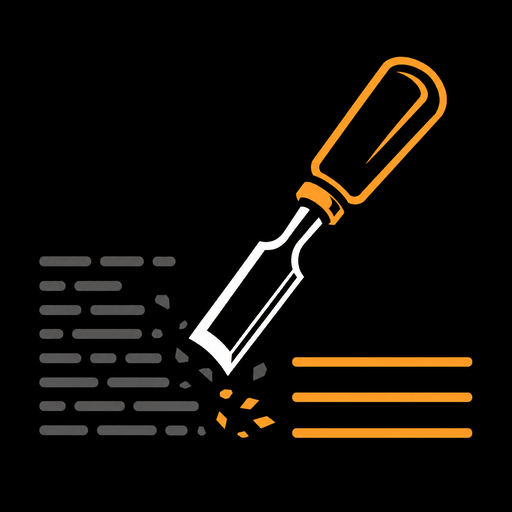
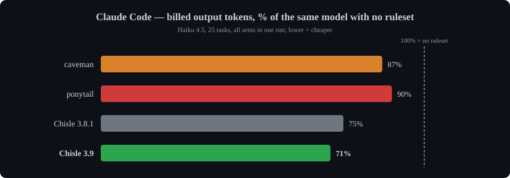
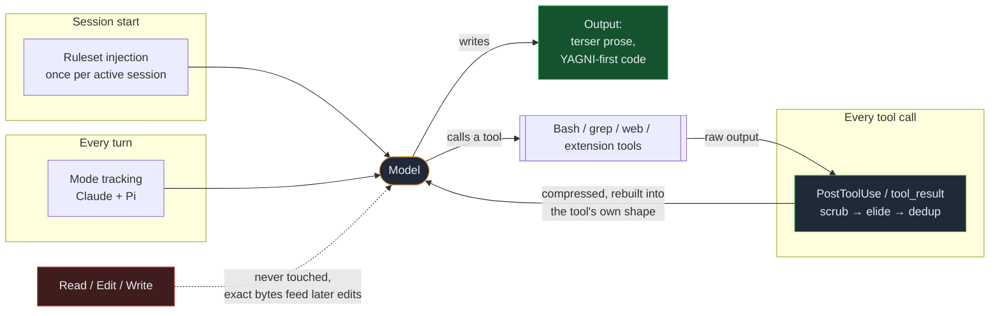
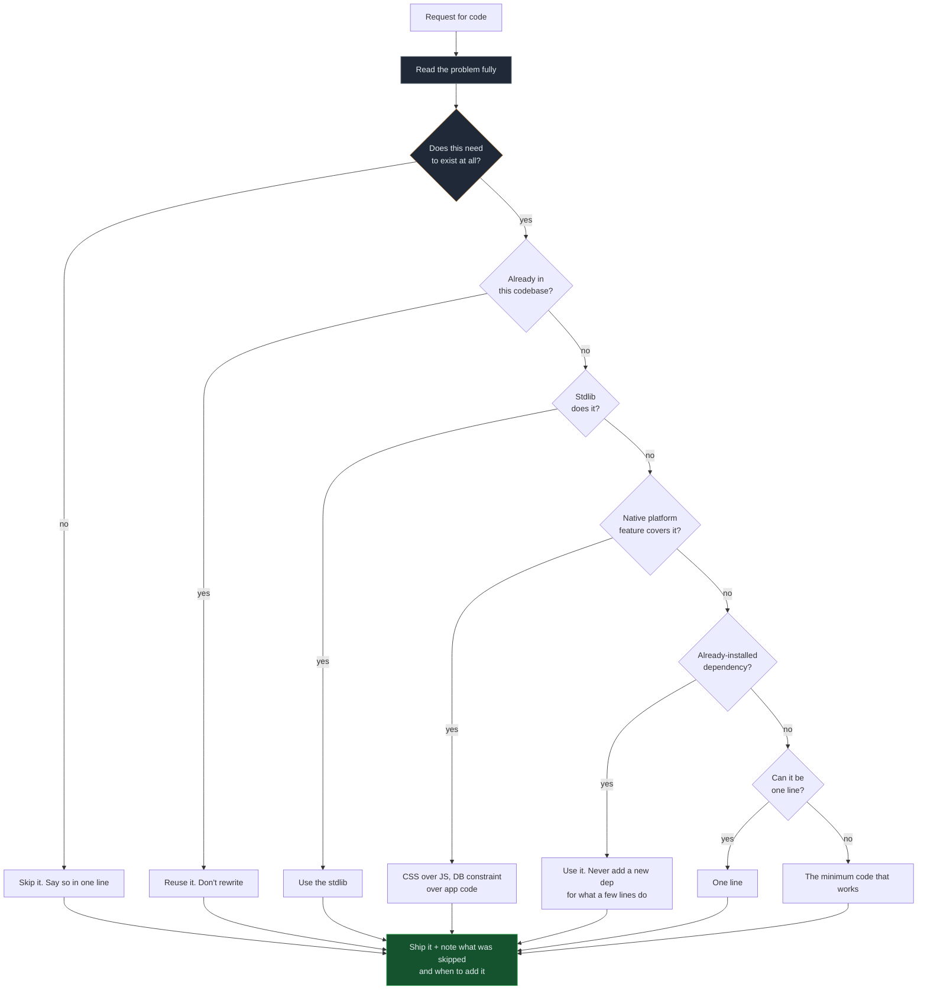

<p align="center">
  
</p>

<h1 align="center">Chisle</h1>

<h3 align="center">Fewer tokens than caveman and ponytail. No accuracy lost.</h3>

<p align="center">
  <em>Your AI talks less, builds less, reads less, and says more. Like a senior dev who bills by the syllable.</em>
</p>

<p align="center">
  <em>The only tool in this class that publishes the runs where it lost. <a href="https://jaypokale.me/writing/chisle-benchmarks-it-loses">Here's why.</a></em>
</p>

<p align="center">
  <a href="https://www.npmjs.com/package/chisle"></a>
  
  <a href="https://github.com/JayPokale/Chisle/actions/workflows/test.yml"></a>
  
  
  <a href="https://github.com/JayPokale/Chisle/stargazers"></a>
</p>

<p align="center">
  <strong>Built for Claude Code: answers about half as long, shorter than caveman and ponytail &middot; 13 agents &middot; zero dependencies &middot; one command</strong>
</p>

Chisle is a Claude Code plugin that makes Claude cheaper to run without making it dumber. It cuts what Claude writes: no filler, no hedging, no speculative abstractions, just the smallest code that works. It also cuts what Claude reads: a `PostToolUse` hook trims oversized tool output by ~48% before it re-enters the context window, where it would be re-billed on every later request. In agent-loop tests Claude with Chisle passes the same tasks as Claude without it. One `npx chisle` installs it, and the same ruleset ships to Pi, Cursor, Codex, Gemini, Copilot, OpenCode, Antigravity and four more agents. Every number here comes from committed raw transcripts, including the runs where it lost.

<p align="center">
  
</p>

<p align="center"><sub>Claude Code + Haiku 4.5, 25 tasks, every arm in one run: billed output tokens vs the same model with no ruleset. Lower is cheaper. <a href="#benchmarks">More below.</a></sub></p>

---

"Implement an order state machine covering created, paid, shipped, delivered, cancelled and refunded, with the legal transitions enforced and invalid ones rejected." Same model, same prompt, one difference: the injected ruleset. Both answers are the **verbatim committed output** from [`raw-nov-sidebyside/large-s2`](benchmarks/results/raw-nov-sidebyside/large-s2/):

<table>
<tr><th align="left" width="50%">bare model: 121 lines, 1,186 answer tokens</th><th align="left" width="50%">Chisle 3.9: 62 lines, 530 answer tokens</th></tr>
<tr valign="top"><td>

A preamble, a custom exception class, docstrings on every method, an extra `can_transition_to` helper:

```python
class OrderStateError(Exception):
    """Raised when an invalid state transition is attempted."""
    pass

class Order:
    # Define valid transitions: state -> list of allowed next states
    VALID_TRANSITIONS = { … }
    def transition_to(self, next_state):
        """Transition to the next state. Raises OrderStateError if invalid."""
    def can_transition_to(self, next_state):
        """Check if a transition is allowed without performing it."""
```

…plus usage, tests, printed output and a recap of the transitions.

</td><td>

Code first, no preamble: one table of legal moves, one method that enforces it:

```python
class OrderStateMachine:
    TRANSITIONS = {
        "created": {"pay", "cancel"},
        "paid": {"ship", "refund", "cancel"},
        …
    }
    def transition(self, event):
        if event not in self.TRANSITIONS[self.state]:
            raise ValueError(f"Cannot {event} from {self.state}. …")
        self.state = self.STATE_MAP[(self.state, event)]
        return self.state
```

Then a short usage block.

</td></tr>
</table>

Same behaviour, under half the tokens. caveman wrote 604 and ponytail 747 on the same prompt.

## What it compresses

| axis | what | how |
|---|---|---|
| **Output: prose** | filler, hedging, manufactured structure | zero-fluff ruleset, injected per session |
| **Output: code** | speculative abstractions, unrequested boilerplate | YAGNI efficiency ladder |
| **Input: context** | oversized tool output flooding the window | Claude `PostToolUse`, Pi `tool_result`, OpenCode plugin, Copilot CLI `postToolUse`: scrub, elide, dedup, plus prevention rules |
| **Input: cache** | a big context re-bought after the prompt cache expires | Claude Code: on the first prompt after an hour-plus break with 150k+ tokens of context, one line suggests `/compact` or `/clear`. On the maintainer's sessions those re-writes were 14% of spend |
| **Input: tool schemas** | schemas of tools you never call, re-sent on every request | `npx chisle tools` reports tool schemas and skill descriptions vs. your own calls; `tools trim` denies the unused heavy tools and lists unused skills name-only, `tools restore` undoes it. On the maintainer's Claude Code: ~5k tokens per request, ~15k with the rarely used `Artifact` |
| **Input: MCP** | oversized MCP tool results in any agent | `npx chisle mcp wrap`: a proxy in front of each stdio MCP server (Cursor, Windsurf, Cline, Kiro, Gemini, Qwen Code, Copilot CLI, Antigravity, Codex, Copilot in VS Code) |

Where each one attaches to a session:



The loop on the right is the input axis: tool output is billed again on *every* later request in the session, so shrinking it once pays repeatedly. `Read`, `Edit`, and `Write` are deliberately outside it.

---

## Install

One command. Auto-detects your agents (Claude Code, Pi, Cursor, Windsurf, Cline, Kiro, Antigravity, Codex, Gemini, Copilot, Copilot CLI, OpenCode, Hermes) and wires each one. `--uninstall` puts everything back. `npx chisle mcp wrap` extends tool-output compression to MCP servers in any agent ([details](INSTALL.md#mcp-output-compression-any-agent)).

```bash
npx chisle
```

```bash
# or via curl
curl -fsSL https://raw.githubusercontent.com/JayPokale/Chisle/main/install.sh | bash
```

```powershell
# Windows
irm https://raw.githubusercontent.com/JayPokale/Chisle/main/install.ps1 | iex
```

Preview first with `npx chisle --dry-run`, scope with `--only claude` or `--only pi`, see everything with `npx chisle --help`. Remove with `npx chisle --uninstall`.

Upgrading, per-agent setup, `--stats` and config: [docs/usage.md](docs/usage.md).

---

## Benchmarks

Same model, same prompts, one difference: the injected ruleset. Lower = leaner. Chisle is the leanest on every row.

**Claude Code, side by side** (Haiku 4.5, 25 live prompts in one run, tools off, [raw cells](benchmarks/results/raw-nov-sidebyside/)):

| % of a bare model | caveman | ponytail | Chisle 3.8.1 | **Chisle 3.9** |
|---|--:|--:|--:|--:|
| billed tokens | 87% | 90% | 75% | **71%** |
| answer length | 59% | 62% | 58% | **55%** |
| answer lines | 55% | 60% | 55% | **45%** |

One run of 25 prompts: gaps of a few points are within run-to-run noise. Intervals and the full 26-prompt suite are in [docs/benchmarks.md](docs/benchmarks.md).

**Sonnet 5.5** (34 live prompts, [raw cells](benchmarks/results/raw-nov-sonnet/)): Chisle 3.9 bills **57%** of the bare model's output tokens (95% CI 50–64%) and answers at 54% of the length. Sonnet decides how much to think, and with Chisle it thinks less (84% of bare), so the shorter answers come straight off the bill.

**Correctness** holds: shorter answers are not wronger ones. Auto-graded, no judge model ([quality cells](benchmarks/quality/raw-nov/), [agentic cells](benchmarks/agentic/raw-nov/)):

| | bare model | **Chisle** |
|---|--:|--:|
| maths + coding, 52 problems × 3 seeds | 154 / 156 | **156 / 156** |
| real repos, hidden tests, 7 fixtures × 6 seeds | 36 / 42 | **38 / 42** |

Neither gap is significant (Fisher p = 0.498, 0.738): Chisle ties the bare model on accuracy while writing 12% fewer output tokens on the graded problems.

**Fixed overhead** (`npx chisle tools trim`). Every request carries every loaded tool's schema and every skill's description. On the agentic suite, denying unused tools took the base request from 22.0k to 18.9k tokens and cost per request from $0.00894 to $0.00801 (**−10%**), at 36/42 vs 38/42 passed: the two lost passes are the `yagni` fixture's planted `|| 3` trap, which the bare model hit on 3 of 6 seeds in the same run, and no run ever called a denied tool. Listing unused skills name-only took a further 937 tokens off the maintainer's base request; in 126 agentic runs no skill was ever invoked, and name-only skills stay callable.

**Tool output** is re-billed on every later turn. Replayed over the maintainer's recent sessions, the compressor makes each oversized output **~48%** smaller and removes 7.1% of all session content; `Read`/`Edit`/`Write` are never touched.

Method and every raw cell: [docs/benchmarks.md](docs/benchmarks.md).

---

## How it works

Before writing code, the agent stops at the first rung that holds:



The ladder runs **after** reading, never instead of it. Note the exit: every rung lands on the same obligation: say what you skipped, so "later" doesn't quietly become "never".

The ladder runs *after* reading the code, lazy about the solution and never about understanding. Lazy is not negligent: trust-boundary validation, data-loss handling, security, and accessibility are never on the chopping block.

## Usage

| Command | Effect |
|---------|--------|
| *(nothing)* | On automatically every session after install |
| `/chisle` | Re-activate if you'd stopped it |
| `/chisle off` | Deactivate |
| `stop chisle` | Deactivate (ruleset *and* input-side compression) |
| `normal mode` | Deactivate |

Natural language works too: "activate chisle", "chisle mode", "chislify this". Code symbols, function/API names, and error strings stay verbatim, so only the noise around them compresses.

---

## Contributing

See [CONTRIBUTING.md](CONTRIBUTING.md). Built by [Jay Pokale](https://github.com/JayPokale) with [Claude](https://claude.com/claude-code), [Antigravity](https://antigravity.google), and [Codex](https://openai.com/blog/openai-codex/) as co-engineers.

## Star History

<a href="https://www.star-history.com/?repos=JayPokale%2FChisle&type=date&legend=top-left">
  <picture>
    <source media="(prefers-color-scheme: dark)" srcset="https://api.star-history.com/svg?repos=JayPokale/Chisle&type=date&legend=top-left&theme=dark">
    <source media="(prefers-color-scheme: light)" srcset="https://api.star-history.com/svg?repos=JayPokale/Chisle&type=date&legend=top-left">
    
  </picture>
</a>

## License

[MIT](LICENSE). The shortest license that works.

Chisle began as a merge of [caveman](https://github.com/JuliusBrussee/caveman) (terse prose) and [ponytail](https://github.com/DietrichGebert/ponytail) (lazy-senior-dev code rules), and its ruleset still carries parts of both. Their MIT notices are in [NOTICE](NOTICE).

## Contributors

<a href="https://github.com/JayPokale/Chisle/graphs/contributors">
  
</a>

**AI co-engineers** (pair-work credited in commit trailers and the changelog):

<p>
  <a href="https://claude.com/claude-code"></a>
  <a href="https://openai.com/codex/"></a>
  <a href="https://antigravity.google/"></a>
</p>

---

<p align="center">
  Saved you tokens? <a href="https://github.com/JayPokale/Chisle">⭐ Star the repo</a>. It costs zero tokens and keeps the benchmarks running.
</p>
