<h1 align="center">
  <picture>
    <source media="(prefers-color-scheme: dark)" srcset="assets/readme/banner-dark.svg">
    
  </picture>
</h1>

<p align="center">
  <a href="https://github.com/JayPokale/Chisle/stargazers"></a>
  <a href="https://www.npmjs.com/package/chisle"></a>
  <a href="https://www.npmjs.com/package/chisle"></a>
  
  
  <a href="https://github.com/JayPokale/Chisle/actions/workflows/test.yml"></a>
  <a href="LICENSE"></a>
  <a href="https://buymeacoffee.com/jaypokale3b"></a>
</p>

<p align="center">
  <a href="#install"><b>Install</b></a>
  &nbsp;·&nbsp;
  <a href="#same-prompt-four-answers"><b>Before / after</b></a>
  &nbsp;·&nbsp;
  <a href="#benchmarks"><b>Benchmarks</b></a>
  &nbsp;·&nbsp;
  <a href="#how-it-works"><b>How it works</b></a>
  &nbsp;·&nbsp;
  <a href="#commands"><b>Commands</b></a>
  &nbsp;·&nbsp;
  <a href="#faq"><b>FAQ</b></a>
</p>

<p align="center">
  <picture>
    <source media="(prefers-color-scheme: dark)" srcset="assets/readme/stats-dark.svg">
    
  </picture>
</p>

<p align="center">
  <strong>Fewer tokens than caveman and ponytail. No accuracy lost.</strong><br>
  <sub>Claude Code + Haiku 4.5, 25 tasks, every ruleset in one run. Accuracy is auto-graded, no judge model.<br>Every raw transcript is committed, <a href="https://jaypokale.me/writing/chisle-benchmarks-it-loses">including the runs where Chisle lost</a>.</sub>
</p>

<p align="center"></p>

Chisle makes Claude Code cheaper to run without making it dumber. It cuts what Claude **writes**: no filler, no hedging, no speculative abstractions, just the smallest code that works. And it cuts what Claude **reads**: oversized tool output is trimmed before it re-enters the context, where it would be billed again on every later turn. One command wires it into Claude Code and 12 more agents.

```bash
npx chisle
```

## Same prompt, four answers

<p align="center">
  <picture>
    <source media="(prefers-color-scheme: dark)" srcset="assets/readme/race-dark.svg">
    
  </picture>
</p>

The prompt: *"Implement an order state machine covering created, paid, shipped, delivered, cancelled and refunded, with the legal transitions enforced and invalid ones rejected."* Excerpts from the verbatim committed answers in [`raw-nov-sidebyside/large-s2`](benchmarks/results/raw-nov-sidebyside/large-s2/):

<table>
<tr><th align="left" width="50%">no ruleset: 121 lines, 1,186 answer tokens</th><th align="left" width="50%">Chisle: 62 lines, 530 answer tokens</th></tr>
<tr valign="top"><td>

A preamble, a custom exception class, docstrings on every method, an extra `can_transition_to` helper:

```python
class OrderStateError(Exception):
    """Raised when an invalid state transition is attempted."""
    pass

class Order:
    # Define valid transitions: state -> list of allowed next states
    VALID_TRANSITIONS = { … }
    def transition_to(self, next_state):
        """Transition to the next state. Raises OrderStateError if invalid."""
    def can_transition_to(self, next_state):
        """Check if a transition is allowed without performing it."""
```

…plus usage, tests, printed output and a recap of the transitions.

</td><td>

Code first, no preamble: one table of legal moves, one method that enforces it:

```python
class OrderStateMachine:
    TRANSITIONS = {
        "created": {"pay", "cancel"},
        "paid": {"ship", "refund", "cancel"},
        …
    }
    def transition(self, event):
        if event not in self.TRANSITIONS[self.state]:
            raise ValueError(f"Cannot {event} from {self.state}. …")
        self.state = self.STATE_MAP[(self.state, event)]
        return self.state
```

Then a short usage block.

</td></tr>
</table>

Same behaviour, under half the tokens.

## Benchmarks

<p align="center">
  <picture>
    <source media="(prefers-color-scheme: dark)" srcset="assets/benchmark.svg">
    
  </picture>
</p>

| % of a bare model, lower is leaner | caveman | ponytail | Chisle 3.8.1 | **Chisle** |
|---|--:|--:|--:|--:|
| billed tokens | 87% | 90% | 75% | **71%** |
| answer length | 59% | 62% | 58% | **55%** |
| answer lines | 55% | 60% | 55% | **45%** |

Claude Code + Haiku 4.5, 25 live prompts in one run, tools off ([raw cells](benchmarks/results/raw-nov-sidebyside/)). One run: gaps of a few points are within run-to-run noise. On **Sonnet 5.5** (34 prompts, [raw cells](benchmarks/results/raw-nov-sonnet/)) Chisle bills **57%** of the bare model's output tokens (95% CI 50–64%): it thinks less, so shorter answers come straight off the bill.

**Shorter is not wronger.** Auto-graded, no judge model ([quality cells](benchmarks/quality/raw-nov/), [agentic cells](benchmarks/agentic/raw-nov/)):

| | bare model | **Chisle** |
|---|--:|--:|
| maths + coding, 52 problems × 3 seeds | 154 / 156 | **156 / 156** |
| real repos, hidden tests, 7 fixtures × 6 seeds | 36 / 42 | **38 / 42** |

Neither gap is significant (Fisher p = 0.498, 0.738). Method, intervals and every raw cell: [docs/benchmarks.md](docs/benchmarks.md).

## Reads less, too

<p align="center">
  <picture>
    <source media="(prefers-color-scheme: dark)" srcset="assets/readme/trim-dark.svg">
    
  </picture>
</p>

Tool output is **67.5%** of session context on a measured Claude Code corpus ([comparison](docs/comparison.md)), and it is billed again on every later request. Chisle's hook strips colour codes, collapses repeated lines, and keeps the first 60 lines, the last 40 and the error lines in between of an oversized output. The full output is saved to a file Claude can grep. Each oversized output gets **~48%** smaller. Deterministic, no LLM call, no network. `Read`, `Edit` and `Write` are never touched: their exact bytes feed later edits.

## What it trims

| axis | what | how |
|---|---|---|
| **Output: prose** | filler, hedging, manufactured structure | zero-fluff ruleset, injected per session |
| **Output: code** | speculative abstractions, unrequested boilerplate | the efficiency ladder below |
| **Input: tool output** | oversized output flooding the window | Claude `PostToolUse`, Pi `tool_result`, OpenCode plugin, Copilot CLI `postToolUse` |
| **Input: MCP** | oversized MCP results in any agent | `npx chisle mcp wrap`, a proxy in front of each stdio MCP server ([details](INSTALL.md#mcp-output-compression-any-agent)) |
| **Input: tool schemas** | schemas of tools you never call, re-sent every request | `npx chisle tools trim`: −10% cost per request on the agentic suite; `tools restore` undoes it |
| **Input: cache** | a big context re-bought after the prompt cache expires | after an hour-plus break with 150k+ tokens of context, one line suggests `/compact` or `/clear` |

## How it works

<p align="center">
  <picture>
    <source media="(prefers-color-scheme: dark)" srcset="assets/readme/ladder-dark.svg">
    
  </picture>
</p>

The ladder runs *after* reading the code, never instead of it: lazy about the solution, never about understanding. Every rung ends the same way: say what was skipped, so "later" doesn't quietly become "never".

Lazy is not negligent: trust-boundary validation, data-loss handling, security and accessibility are never on the chopping block.

## Install

<p align="center">
  <picture>
    <source media="(prefers-color-scheme: dark)" srcset="assets/readme/agents-dark.svg">
    
  </picture>
</p>

```bash
npx chisle
```

It finds every agent on your machine and wires each one. `npx chisle --uninstall` puts everything back.

> [!TIP]
> Preview first with `npx chisle --dry-run`, or limit it to one agent with `--only claude` or `--only pi`.

<details>
<summary><b>Other ways to install</b></summary>
<br>

**Claude Code plugin marketplace**

```bash
claude plugin marketplace add JayPokale/Chisle
claude plugin install chisle@chisle
```

**curl**

```bash
curl -fsSL https://raw.githubusercontent.com/JayPokale/Chisle/main/install.sh | bash
```

**Windows (PowerShell)**

```powershell
irm https://raw.githubusercontent.com/JayPokale/Chisle/main/install.ps1 | iex
```

Per-agent setup, upgrading, `--stats` and config: [docs/usage.md](docs/usage.md).

</details>

## Commands

| Command | What it does |
|---------|--------------|
| *(nothing)* | On automatically every session after install |
| `/chisle` | Turn it back on if you stopped it |
| `/chisle off`, `stop chisle`, `normal mode` | Turn it off (ruleset *and* tool-output trimming) |
| `/chisle-review` | Review a diff for over-engineering: one finding per line, no praise |
| `/chisle-audit` | Audit a diff, a file or the repo for bloated code *and* bloated prose, biggest cut first |
| `/chisle-help` | Quick reference card |
| `npx chisle tools` | Show the tool schemas and skills you pay for but never use; `tools trim` / `tools restore` |
| `npx chisle mcp wrap` | Trim oversized MCP tool output in any agent |

Code, function names, API names and error strings stay verbatim: only the noise around them compresses.

## FAQ

<details>
<summary><b>Does it make Claude dumber?</b></summary>
<br>

No measurable change: 156/156 vs 154/156 on graded problems, and 38/42 vs 36/42 on real repos with hidden tests. Neither gap is significant. [Method](docs/benchmarks.md).

</details>

<details>
<summary><b>Can trimming lose something Claude needed?</b></summary>
<br>

Error lines from the trimmed middle are kept, and an elided output is saved in full to a file Claude can search. `Read`, `Edit` and `Write` output is never changed.

</details>

<details>
<summary><b>Does it call another model to compress?</b></summary>
<br>

No. Plain rules and a local hook, with zero dependencies.

</details>

<details>
<summary><b>Why publish the runs where it lost?</b></summary>
<br>

Because a benchmark you can't check is an ad. [The longer answer](https://jaypokale.me/writing/chisle-benchmarks-it-loses).

</details>

<details>
<summary><b>Where should I install it from?</b></summary>
<br>

Only from `chisle` on npm or `JayPokale/Chisle` on GitHub. Releases are published from CI with npm provenance.

</details>

<details>
<summary><b>Why "Chisle"?</b></summary>
<br>

A chisel removes everything that isn't the statue.

</details>

## Support Chisle

<p align="center">
  <a href="https://buymeacoffee.com/jaypokale3b"></a>
</p>

<p align="center">
  Saved you tokens? <a href="https://github.com/JayPokale/Chisle/stargazers">⭐ Star the repo</a>. It costs zero tokens and keeps the benchmarks running.
</p>

## Contributing

See [CONTRIBUTING.md](CONTRIBUTING.md). Built by [Jay Pokale](https://github.com/JayPokale) with [Claude](https://claude.com/claude-code), [Antigravity](https://antigravity.google) and [Codex](https://openai.com/codex/) as co-engineers.

<a href="https://github.com/JayPokale/Chisle/graphs/contributors">
  
</a>

## Star history

<a href="https://www.star-history.com/?repos=JayPokale%2FChisle&type=date&legend=top-left">
  <picture>
    <source media="(prefers-color-scheme: dark)" srcset="https://api.star-history.com/svg?repos=JayPokale/Chisle&type=date&legend=top-left&theme=dark">
    <source media="(prefers-color-scheme: light)" srcset="https://api.star-history.com/svg?repos=JayPokale/Chisle&type=date&legend=top-left">
    
  </picture>
</a>

## License

[MIT](LICENSE). The shortest license that works.

Chisle began as a merge of [caveman](https://github.com/JuliusBrussee/caveman) (terse prose) and [ponytail](https://github.com/DietrichGebert/ponytail) (lazy-senior-dev code rules), and its ruleset still carries parts of both. Their MIT notices are in [NOTICE](NOTICE).

<p align="center"></p>

<p align="center"><sub>Built with fewer tokens.</sub></p>
