<!-- Translated from ../README.md. Keep images, numbers and links in sync with it. -->
<h1 align="center">
  <picture>
    <source media="(prefers-color-scheme: dark)" srcset="../assets/readme/es/banner-dark.svg">
    
  </picture>
</h1>

<p align="center">
  <a href="https://github.com/JayPokale/Chisle/stargazers"></a>
  <a href="https://www.npmjs.com/package/chisle"></a>
  <a href="https://www.npmjs.com/package/chisle"></a>
  
  <a href="../LICENSE"></a>
  <a href="https://github.com/JayPokale"></a>
  <a href="https://buymeacoffee.com/jaypokale3b"></a>
</p>

<p align="center">
  <sub><a href="../README.md">English</a> &middot; <b>Español</b> &middot; <a href="README.ko.md">한국어</a> &middot; <a href="README.zh-CN.md">简体中文</a> &middot; <a href="README.ja.md">日本語</a></sub>
</p>

<p align="center">
  <picture>
    <source media="(prefers-color-scheme: dark)" srcset="../assets/readme/es/stats-dark.svg">
    
  </picture>
</p>

<p align="center"><b>Respuestas más cortas que caveman y ponytail. Sin perder precisión.</b></p>

```bash
npx chisle
```

<p align="center">
  <a href="https://buymeacoffee.com/jaypokale3b">
    <picture>
      <source media="(prefers-color-scheme: dark)" srcset="../assets/readme/es/strip-dark.svg">
      
    </picture>
  </a>
</p>

<p align="center"></p>

<p align="center">
  <picture>
    <source media="(prefers-color-scheme: dark)" srcset="../assets/readme/es/race-dark.svg">
    
  </picture>
</p>

<details>
<summary><b>Ver ambas respuestas</b></summary>
<br>

El prompt: *"Implement an order state machine covering created, paid, shipped, delivered, cancelled and refunded, with the legal transitions enforced and invalid ones rejected."* Extractos de las respuestas literales guardadas en [`raw-314-direct/large-s2`](../benchmarks/results/raw-314-direct/large-s2/):

<table>
<tr><th align="left" width="50%">sin ruleset: 132 líneas, 1.307 tokens de respuesta</th><th align="left" width="50%">Chisle: 60 líneas, 577 tokens de respuesta</th></tr>
<tr valign="top"><td>

```python
class StateTransition:
    """Defines valid state transitions"""
    from_state: OrderState
    to_states: Set[OrderState]

class OrderStateMachine:
    # Define all valid transitions
    TRANSITIONS = {
        OrderState.CREATED: {OrderState.PAID, OrderState.CANCELLED},
        …
    }
    def __init__(self, order_id: str):
        …
        self.state_history = [(OrderState.CREATED, datetime.now())]
    def can_transition(self, target_state: OrderState) -> bool:
    def transition(self, target_state: OrderState) -> bool:
        """
        Attempt to transition to target_state.
        Returns True if successful, False if invalid.
        """
    def get_valid_transitions(self) -> Set[OrderState]:
```

…más una clase `StateTransition` que nada usa, ejemplos de uso y pruebas, y las secciones «Key Design Decisions», «Why these transitions» y «Features».

</td><td>

```python
class OrderStateMachine:
    VALID_TRANSITIONS: Dict[OrderState, Set[OrderState]] = {
        OrderState.CREATED: {OrderState.PAID, OrderState.CANCELLED},
        OrderState.PAID: {OrderState.SHIPPED, OrderState.REFUNDED, OrderState.CANCELLED},
        …
    }
    def transition(self, target: OrderState) -> None:
        if target not in self.VALID_TRANSITIONS[self.state]:
            raise ValueError(
                f"Invalid transition: {self.state.value} → {target.value}"
            )
        self.state = target
```

Luego un ejemplo breve y una lista de cinco líneas con las transiciones.

</td></tr>
</table>

</details>

<p align="center"></p>

<p align="center">
  <picture>
    <source media="(prefers-color-scheme: dark)" srcset="../assets/benchmark-opus.svg">
    
  </picture>
</p>

<p align="center">
  <picture>
    <source media="(prefers-color-scheme: dark)" srcset="../assets/benchmark-sonnet.svg">
    
  </picture>
</p>

<p align="center">
  <picture>
    <source media="(prefers-color-scheme: dark)" srcset="../assets/benchmark.svg">
    
  </picture>
</p>

<p align="center">
  <picture>
    <source media="(prefers-color-scheme: dark)" srcset="../assets/benchmark-terminal.svg">
    
  </picture>
</p>

<p align="center">
  <picture>
    <source media="(prefers-color-scheme: dark)" srcset="../assets/benchmark-cost.svg">
    
  </picture>
</p>

<p align="center"><sub><b>Una tarea con todo a la vez</b> (<code>releasered</code>): los tests pasan en el tag <code>v2.0.0</code> y fallan seis commits después, por dos fallos sin relación. El agente ejecuta una suite de 517 tests (log de 27k caracteres), lee el historial y el diff desde el tag, arregla dos archivos y repite hasta que todo pasa. Coste como % de sin reglas, sin contar el prompt de cada ruleset (en caché), sin RTK; todas las ejecuciones arreglaron los dos fallos.</sub></p>

<div align="center">
<table>
<tr><th></th><th>Haiku 4.5 (5 ejecuciones)</th><th>Sonnet 5.5 (3 ejecuciones)</th><th>Opus 5.5 (3 ejecuciones)</th></tr>
<tr><td>sin reglas</td><td>100%</td><td>100%</td><td>100%</td></tr>
<tr><td>caveman</td><td>97%</td><td>94%</td><td>97%</td></tr>
<tr><td>ponytail</td><td>102%</td><td>104%</td><td>102%</td></tr>
<tr><td><b>Chisle</b></td><td><b>61%</b></td><td><b>88%</b></td><td><b>81%</b></td></tr>
</table>
</div>

<p align="center"><sub>Todas las transcripciones originales están en el repo, derrotas incluidas. <a href="../docs/benchmarks.md">Método y datos</a> · <a href="https://jaypokale.me/writing/chisle-benchmarks-it-loses">por qué publicamos las derrotas</a></sub></p>

<p align="center"></p>

<p align="center">
  <picture>
    <source media="(prefers-color-scheme: dark)" srcset="../assets/readme/es/trim-dark.svg">
    
  </picture>
</p>

<p align="center">
  <picture>
    <source media="(prefers-color-scheme: dark)" srcset="../assets/readme/es/filters-dark.svg">
    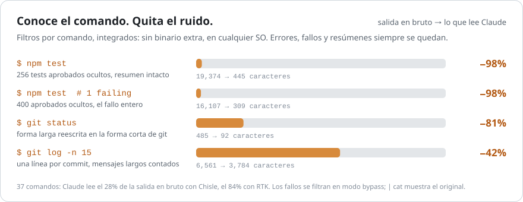
  </picture>
</p>

<p align="center"></p>

<p align="center">
  <picture>
    <source media="(prefers-color-scheme: dark)" srcset="../assets/readme/es/ladder-dark.svg">
    
  </picture>
</p>

<p align="center"></p>

<p align="center">
  <picture>
    <source media="(prefers-color-scheme: dark)" srcset="../assets/readme/install-dark.svg">
    
  </picture>
</p>

<details>
<summary><b>Otras formas de instalar</b></summary>
<br>

```bash
# Marketplace de plugins de Claude Code
claude plugin marketplace add JayPokale/Chisle
claude plugin install chisle@chisle

# curl
curl -fsSL https://raw.githubusercontent.com/JayPokale/Chisle/main/install.sh | bash
```

```powershell
# Windows
irm https://raw.githubusercontent.com/JayPokale/Chisle/main/install.ps1 | iex
```

Configuración por agente, actualizaciones y opciones: [docs/usage.md](../docs/usage.md).

</details>

<p align="center"></p>

<p align="center">
  <picture>
    <source media="(prefers-color-scheme: dark)" srcset="../assets/readme/es/commands-dark.svg">
    
  </picture>
</p>

<p align="center"></p>

<p align="center">
  <a href="https://www.star-history.com/?repos=JayPokale%2FChisle&type=date&legend=top-left">
    <picture>
      <source media="(prefers-color-scheme: dark)" srcset="https://api.star-history.com/svg?repos=jaypokale%2Fchisle&type=date&legend=top-left&theme=dark">
      
    </picture>
  </a>
</p>

<p align="center"></p>

<p align="center">
  <a href="https://buymeacoffee.com/jaypokale3b">
    <picture>
      <source media="(prefers-color-scheme: dark)" srcset="../assets/readme/es/support-dark.svg">
      
    </picture>
  </a>
</p>

<p align="center"><a href="https://github.com/JayPokale/Chisle/stargazers">⭐ Dale una estrella al repo</a>: no cuesta ni un token.</p>

<p align="center">
  <a href="https://github.com/JayPokale/Chisle/graphs/contributors"></a>
</p>

<p align="center"><sub><a href="../LICENSE">MIT</a> · <a href="../CONTRIBUTING.md">Contribuir</a> · Nació como una fusión de <a href="https://github.com/JuliusBrussee/caveman">caveman</a> y <a href="https://github.com/DietrichGebert/ponytail">ponytail</a> (<a href="../NOTICE">avisos</a>) · Filtros de comandos basados en el diseño de <a href="https://github.com/rtk-ai/rtk">RTK</a></sub></p>
