<!-- Translated from ../README.md. Keep images, numbers and links in sync with it. -->
<h1 align="center">
  <picture>
    <source media="(prefers-color-scheme: dark)" srcset="../assets/readme/banner-dark.svg">
    
  </picture>
</h1>

<p align="center">
  <a href="https://github.com/JayPokale/Chisle/stargazers"></a>
  <a href="https://www.npmjs.com/package/chisle"></a>
  <a href="https://www.npmjs.com/package/chisle"></a>
  
  <a href="../LICENSE"></a>
  <a href="https://buymeacoffee.com/jaypokale3b"></a>
</p>

<p align="center">
  <sub><a href="../README.md">English</a> &middot; <b>Español</b> &middot; <a href="README.ko.md">한국어</a> &middot; <a href="README.zh-CN.md">简体中文</a> &middot; <a href="README.ja.md">日本語</a></sub>
</p>

<p align="center">
  <picture>
    <source media="(prefers-color-scheme: dark)" srcset="../assets/readme/stats-dark.svg">
    
  </picture>
</p>

<p align="center"><b>Menos tokens que caveman y ponytail. Sin perder precisión.</b></p>

```bash
npx chisle
```

<p align="center">
  <a href="https://buymeacoffee.com/jaypokale3b">
    <picture>
      <source media="(prefers-color-scheme: dark)" srcset="../assets/readme/strip-dark.svg">
      
    </picture>
  </a>
</p>

<p align="center"></p>

<p align="center">
  <picture>
    <source media="(prefers-color-scheme: dark)" srcset="../assets/readme/race-dark.svg">
    
  </picture>
</p>

<details>
<summary><b>Ver ambas respuestas</b></summary>
<br>

El prompt: *"Implement an order state machine covering created, paid, shipped, delivered, cancelled and refunded, with the legal transitions enforced and invalid ones rejected."* Extractos de las respuestas literales guardadas en [`raw-nov-sidebyside/large-s2`](../benchmarks/results/raw-nov-sidebyside/large-s2/):

<table>
<tr><th align="left" width="50%">sin ruleset: 121 líneas, 1.186 tokens de respuesta</th><th align="left" width="50%">Chisle: 62 líneas, 530 tokens de respuesta</th></tr>
<tr valign="top"><td>

```python
class OrderStateError(Exception):
    """Raised when an invalid state transition is attempted."""
    pass

class Order:
    # Define valid transitions: state -> list of allowed next states
    VALID_TRANSITIONS = { … }
    def transition_to(self, next_state):
        """Transition to the next state. Raises OrderStateError if invalid."""
    def can_transition_to(self, next_state):
        """Check if a transition is allowed without performing it."""
```

…más ejemplos de uso, tests, salida impresa y un resumen de las transiciones.

</td><td>

```python
class OrderStateMachine:
    TRANSITIONS = {
        "created": {"pay", "cancel"},
        "paid": {"ship", "refund", "cancel"},
        …
    }
    def transition(self, event):
        if event not in self.TRANSITIONS[self.state]:
            raise ValueError(f"Cannot {event} from {self.state}. …")
        self.state = self.STATE_MAP[(self.state, event)]
        return self.state
```

Después, un bloque corto de uso.

</td></tr>
</table>

</details>

<p align="center"></p>

<p align="center">
  <picture>
    <source media="(prefers-color-scheme: dark)" srcset="../assets/benchmark.svg">
    
  </picture>
</p>

<p align="center"><sub>Todas las transcripciones originales están en el repo, derrotas incluidas. <a href="../docs/benchmarks.md">Método y datos</a> · <a href="https://jaypokale.me/writing/chisle-benchmarks-it-loses">por qué publicamos las derrotas</a></sub></p>

<p align="center"></p>

<p align="center">
  <picture>
    <source media="(prefers-color-scheme: dark)" srcset="../assets/readme/trim-dark.svg">
    
  </picture>
</p>

<p align="center"></p>

<p align="center">
  <picture>
    <source media="(prefers-color-scheme: dark)" srcset="../assets/readme/ladder-dark.svg">
    
  </picture>
</p>

<p align="center"></p>

<p align="center">
  <picture>
    <source media="(prefers-color-scheme: dark)" srcset="../assets/readme/install-dark.svg">
    
  </picture>
</p>

<details>
<summary><b>Otras formas de instalar</b></summary>
<br>

```bash
# Marketplace de plugins de Claude Code
claude plugin marketplace add JayPokale/Chisle
claude plugin install chisle@chisle

# curl
curl -fsSL https://raw.githubusercontent.com/JayPokale/Chisle/main/install.sh | bash
```

```powershell
# Windows
irm https://raw.githubusercontent.com/JayPokale/Chisle/main/install.ps1 | iex
```

Configuración por agente, actualizaciones y opciones: [docs/usage.md](../docs/usage.md).

</details>

<p align="center"></p>

<p align="center">
  <picture>
    <source media="(prefers-color-scheme: dark)" srcset="../assets/readme/commands-dark.svg">
    
  </picture>
</p>

<p align="center"></p>

<p align="center">
  <a href="https://www.star-history.com/#JayPokale/Chisle&Date">
    <picture>
      <source media="(prefers-color-scheme: dark)" srcset="https://raw.githubusercontent.com/JayPokale/Chisle/stars/stars-dark.svg">
      
    </picture>
  </a>
</p>

<p align="center"></p>

<p align="center">
  <a href="https://buymeacoffee.com/jaypokale3b">
    <picture>
      <source media="(prefers-color-scheme: dark)" srcset="../assets/readme/support-dark.svg">
      
    </picture>
  </a>
</p>

<p align="center"><a href="https://github.com/JayPokale/Chisle/stargazers">⭐ Dale una estrella al repo</a>: no cuesta ni un token.</p>

<p align="center">
  <a href="https://github.com/JayPokale/Chisle/graphs/contributors"></a>
</p>

<p align="center"><sub><a href="../LICENSE">MIT</a> · <a href="../CONTRIBUTING.md">Contribuir</a> · Nació como una fusión de <a href="https://github.com/JuliusBrussee/caveman">caveman</a> y <a href="https://github.com/DietrichGebert/ponytail">ponytail</a> (<a href="../NOTICE">avisos</a>)</sub></p>
