<!-- Translated from ../README.md. Keep images, numbers and links in sync with it. -->
<h1 align="center">
  <picture>
    <source media="(prefers-color-scheme: dark)" srcset="../assets/readme/ja/banner-dark.svg">
    
  </picture>
</h1>

<p align="center">
  <a href="https://github.com/JayPokale/Chisle/stargazers"></a>
  <a href="https://www.npmjs.com/package/chisle"></a>
  <a href="https://www.npmjs.com/package/chisle"></a>
  
  <a href="../LICENSE"></a>
  <a href="https://github.com/JayPokale"></a>
  <a href="https://buymeacoffee.com/jaypokale3b"></a>
</p>

<p align="center">
  <sub><a href="../README.md">English</a> &middot; <a href="README.es.md">Español</a> &middot; <a href="README.ko.md">한국어</a> &middot; <a href="README.zh-CN.md">简体中文</a> &middot; <b>日本語</b></sub>
</p>

<p align="center">
  <picture>
    <source media="(prefers-color-scheme: dark)" srcset="../assets/readme/ja/stats-dark.svg">
    
  </picture>
</p>

<p align="center"><b>caveman や ponytail より短い回答、精度はそのまま。</b></p>

```bash
npx chisle
```

<p align="center">
  <a href="https://buymeacoffee.com/jaypokale3b">
    <picture>
      <source media="(prefers-color-scheme: dark)" srcset="../assets/readme/ja/strip-dark.svg">
      
    </picture>
  </a>
</p>

<p align="center"></p>

<p align="center">
  <picture>
    <source media="(prefers-color-scheme: dark)" srcset="../assets/readme/ja/race-dark.svg">
    
  </picture>
</p>

<details>
<summary><b>両方の回答を見る</b></summary>
<br>

プロンプト：*"Implement an order state machine covering created, paid, shipped, delivered, cancelled and refunded, with the legal transitions enforced and invalid ones rejected."* コミット済みの回答原文からの抜粋です：[`raw-314-direct/large-s2`](../benchmarks/results/raw-314-direct/large-s2/)

<table>
<tr><th align="left" width="50%">ルールなし：132 行、回答トークン 1,307</th><th align="left" width="50%">Chisle：60 行、回答トークン 577</th></tr>
<tr valign="top"><td>

```python
class StateTransition:
    """Defines valid state transitions"""
    from_state: OrderState
    to_states: Set[OrderState]

class OrderStateMachine:
    # Define all valid transitions
    TRANSITIONS = {
        OrderState.CREATED: {OrderState.PAID, OrderState.CANCELLED},
        …
    }
    def __init__(self, order_id: str):
        …
        self.state_history = [(OrderState.CREATED, datetime.now())]
    def can_transition(self, target_state: OrderState) -> bool:
    def transition(self, target_state: OrderState) -> bool:
        """
        Attempt to transition to target_state.
        Returns True if successful, False if invalid.
        """
    def get_valid_transitions(self) -> Set[OrderState]:
```

…さらにどこからも使われない `StateTransition` クラス、使用例とテスト、「Key Design Decisions」「Why these transitions」「Features」の各セクション。

</td><td>

```python
class OrderStateMachine:
    VALID_TRANSITIONS: Dict[OrderState, Set[OrderState]] = {
        OrderState.CREATED: {OrderState.PAID, OrderState.CANCELLED},
        OrderState.PAID: {OrderState.SHIPPED, OrderState.REFUNDED, OrderState.CANCELLED},
        …
    }
    def transition(self, target: OrderState) -> None:
        if target not in self.VALID_TRANSITIONS[self.state]:
            raise ValueError(
                f"Invalid transition: {self.state.value} → {target.value}"
            )
        self.state = target
```

そのあと短い使用例と、遷移を 5 行でまとめた一覧。

</td></tr>
</table>

</details>

<p align="center"></p>

<p align="center">
  <picture>
    <source media="(prefers-color-scheme: dark)" srcset="../assets/benchmark.svg">
    
  </picture>
</p>

<p align="center">
  <picture>
    <source media="(prefers-color-scheme: dark)" srcset="../assets/benchmark-terminal.svg">
    
  </picture>
</p>

<p align="center">
  <picture>
    <source media="(prefers-color-scheme: dark)" srcset="../assets/benchmark-cost.svg">
    
  </picture>
</p>

<p align="center"><sub>負けた実行も含め、生のログはすべてコミット済みです。<a href="../docs/benchmarks.md">手法とデータ</a> · <a href="https://jaypokale.me/writing/chisle-benchmarks-it-loses">負けた結果も公開する理由</a></sub></p>

<p align="center"></p>

<p align="center">
  <picture>
    <source media="(prefers-color-scheme: dark)" srcset="../assets/readme/ja/trim-dark.svg">
    
  </picture>
</p>

<p align="center">
  <picture>
    <source media="(prefers-color-scheme: dark)" srcset="../assets/readme/ja/filters-dark.svg">
    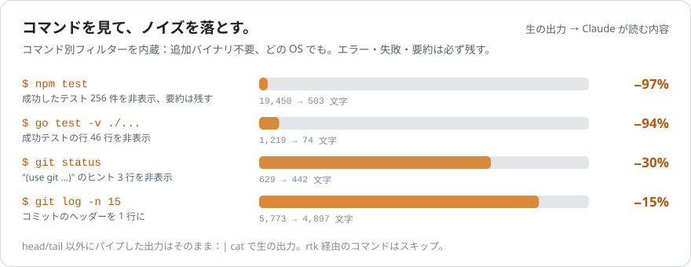
  </picture>
</p>

<p align="center"></p>

<p align="center">
  <picture>
    <source media="(prefers-color-scheme: dark)" srcset="../assets/readme/ja/ladder-dark.svg">
    
  </picture>
</p>

<p align="center"></p>

<p align="center">
  <picture>
    <source media="(prefers-color-scheme: dark)" srcset="../assets/readme/install-dark.svg">
    
  </picture>
</p>

<details>
<summary><b>その他のインストール方法</b></summary>
<br>

```bash
# Claude Code プラグインマーケットプレイス
claude plugin marketplace add JayPokale/Chisle
claude plugin install chisle@chisle

# curl
curl -fsSL https://raw.githubusercontent.com/JayPokale/Chisle/main/install.sh | bash
```

```powershell
# Windows
irm https://raw.githubusercontent.com/JayPokale/Chisle/main/install.ps1 | iex
```

エージェントごとの設定、アップグレード、設定：[docs/usage.md](../docs/usage.md)。

</details>

<p align="center"></p>

<p align="center">
  <picture>
    <source media="(prefers-color-scheme: dark)" srcset="../assets/readme/ja/commands-dark.svg">
    
  </picture>
</p>

<p align="center"></p>

<p align="center">
  <a href="https://www.star-history.com/?repos=JayPokale%2FChisle&type=date&legend=top-left">
    <picture>
      <source media="(prefers-color-scheme: dark)" srcset="https://api.star-history.com/svg?repos=jaypokale%2Fchisle&type=date&legend=top-left&theme=dark">
      
    </picture>
  </a>
</p>

<p align="center"></p>

<p align="center">
  <a href="https://buymeacoffee.com/jaypokale3b">
    <picture>
      <source media="(prefers-color-scheme: dark)" srcset="../assets/readme/ja/support-dark.svg">
      
    </picture>
  </a>
</p>

<p align="center"><a href="https://github.com/JayPokale/Chisle/stargazers">⭐ リポジトリにスターを</a>：トークンは 1 つもかかりません。</p>

<p align="center">
  <a href="https://github.com/JayPokale/Chisle/graphs/contributors"></a>
</p>

<p align="center"><sub><a href="../LICENSE">MIT</a> · <a href="../CONTRIBUTING.md">コントリビュート</a> · <a href="https://github.com/JuliusBrussee/caveman">caveman</a> と <a href="https://github.com/DietrichGebert/ponytail">ponytail</a> の統合から誕生（<a href="../NOTICE">表記</a>）· コマンドフィルターは <a href="https://github.com/rtk-ai/rtk">RTK</a> の設計がベース</sub></p>
