<!-- Translated from ../README.md. Keep images, numbers and links in sync with it. -->
<h1 align="center">
  <picture>
    <source media="(prefers-color-scheme: dark)" srcset="../assets/readme/ko/banner-dark.svg">
    
  </picture>
</h1>

<p align="center">
  <a href="https://github.com/JayPokale/Chisle/stargazers"></a>
  <a href="https://www.npmjs.com/package/chisle"></a>
  <a href="https://www.npmjs.com/package/chisle"></a>
  
  <a href="../LICENSE"></a>
  <a href="https://buymeacoffee.com/jaypokale3b"></a>
</p>

<p align="center">
  <sub><a href="../README.md">English</a> &middot; <a href="README.es.md">Español</a> &middot; <b>한국어</b> &middot; <a href="README.zh-CN.md">简体中文</a> &middot; <a href="README.ja.md">日本語</a></sub>
</p>

<p align="center">
  <picture>
    <source media="(prefers-color-scheme: dark)" srcset="../assets/readme/ko/stats-dark.svg">
    
  </picture>
</p>

<p align="center"><b>caveman과 ponytail보다 적은 토큰. 정확도 손실 없음.</b></p>

```bash
npx chisle
```

<p align="center">
  <a href="https://buymeacoffee.com/jaypokale3b">
    <picture>
      <source media="(prefers-color-scheme: dark)" srcset="../assets/readme/ko/strip-dark.svg">
      
    </picture>
  </a>
</p>

<p align="center"></p>

<p align="center">
  <picture>
    <source media="(prefers-color-scheme: dark)" srcset="../assets/readme/ko/race-dark.svg">
    
  </picture>
</p>

<details>
<summary><b>두 답변 보기</b></summary>
<br>

프롬프트: *"Implement an order state machine covering created, paid, shipped, delivered, cancelled and refunded, with the legal transitions enforced and invalid ones rejected."* 커밋된 원본 답변에서 발췌했습니다: [`raw-nov-sidebyside/large-s2`](../benchmarks/results/raw-nov-sidebyside/large-s2/)

<table>
<tr><th align="left" width="50%">규칙 없음: 121줄, 답변 토큰 1,186개</th><th align="left" width="50%">Chisle: 62줄, 답변 토큰 530개</th></tr>
<tr valign="top"><td>

```python
class OrderStateError(Exception):
    """Raised when an invalid state transition is attempted."""
    pass

class Order:
    # Define valid transitions: state -> list of allowed next states
    VALID_TRANSITIONS = { … }
    def transition_to(self, next_state):
        """Transition to the next state. Raises OrderStateError if invalid."""
    def can_transition_to(self, next_state):
        """Check if a transition is allowed without performing it."""
```

…여기에 사용 예시, 테스트, 출력 결과, 전이 요약까지.

</td><td>

```python
class OrderStateMachine:
    TRANSITIONS = {
        "created": {"pay", "cancel"},
        "paid": {"ship", "refund", "cancel"},
        …
    }
    def transition(self, event):
        if event not in self.TRANSITIONS[self.state]:
            raise ValueError(f"Cannot {event} from {self.state}. …")
        self.state = self.STATE_MAP[(self.state, event)]
        return self.state
```

그다음 짧은 사용 예시.

</td></tr>
</table>

</details>

<p align="center"></p>

<p align="center">
  <picture>
    <source media="(prefers-color-scheme: dark)" srcset="../assets/benchmark.svg">
    
  </picture>
</p>

<p align="center"><sub>진 결과까지 포함해 모든 원본 기록이 커밋되어 있습니다. <a href="../docs/benchmarks.md">방법과 데이터</a> · <a href="https://jaypokale.me/writing/chisle-benchmarks-it-loses">진 결과를 공개하는 이유</a></sub></p>

<p align="center"></p>

<p align="center">
  <picture>
    <source media="(prefers-color-scheme: dark)" srcset="../assets/readme/ko/trim-dark.svg">
    
  </picture>
</p>

<p align="center"></p>

<p align="center">
  <picture>
    <source media="(prefers-color-scheme: dark)" srcset="../assets/readme/ko/ladder-dark.svg">
    
  </picture>
</p>

<p align="center"></p>

<p align="center">
  <picture>
    <source media="(prefers-color-scheme: dark)" srcset="../assets/readme/install-dark.svg">
    
  </picture>
</p>

<details>
<summary><b>다른 설치 방법</b></summary>
<br>

```bash
# Claude Code 플러그인 마켓플레이스
claude plugin marketplace add JayPokale/Chisle
claude plugin install chisle@chisle

# curl
curl -fsSL https://raw.githubusercontent.com/JayPokale/Chisle/main/install.sh | bash
```

```powershell
# Windows
irm https://raw.githubusercontent.com/JayPokale/Chisle/main/install.ps1 | iex
```

에이전트별 설정, 업그레이드, 설정: [docs/usage.md](../docs/usage.md).

</details>

<p align="center"></p>

<p align="center">
  <picture>
    <source media="(prefers-color-scheme: dark)" srcset="../assets/readme/ko/commands-dark.svg">
    
  </picture>
</p>

<p align="center"></p>

<p align="center">
  <a href="https://www.star-history.com/#JayPokale/Chisle&Date">
    <picture>
      <source media="(prefers-color-scheme: dark)" srcset="https://raw.githubusercontent.com/JayPokale/Chisle/stars/stars-dark.svg">
      
    </picture>
  </a>
</p>

<p align="center"></p>

<p align="center">
  <a href="https://buymeacoffee.com/jaypokale3b">
    <picture>
      <source media="(prefers-color-scheme: dark)" srcset="../assets/readme/ko/support-dark.svg">
      
    </picture>
  </a>
</p>

<p align="center"><a href="https://github.com/JayPokale/Chisle/stargazers">⭐ 저장소에 별 주기</a>: 토큰은 하나도 들지 않습니다.</p>

<p align="center">
  <a href="https://github.com/JayPokale/Chisle/graphs/contributors"></a>
</p>

<p align="center"><sub><a href="../LICENSE">MIT</a> · <a href="../CONTRIBUTING.md">기여하기</a> · <a href="https://github.com/JuliusBrussee/caveman">caveman</a>과 <a href="https://github.com/DietrichGebert/ponytail">ponytail</a>을 합치며 시작 (<a href="../NOTICE">고지</a>)</sub></p>
