<!-- Translated from ../README.md. Keep images, numbers and links in sync with it. -->
<h1 align="center">
  <picture>
    <source media="(prefers-color-scheme: dark)" srcset="../assets/readme/zh-CN/banner-dark.svg">
    
  </picture>
</h1>

<p align="center">
  <a href="https://github.com/JayPokale/Chisle/stargazers"></a>
  <a href="https://www.npmjs.com/package/chisle"></a>
  <a href="https://www.npmjs.com/package/chisle"></a>
  
  <a href="../LICENSE"></a>
  <a href="https://github.com/JayPokale"></a>
  <a href="https://buymeacoffee.com/jaypokale3b"></a>
</p>

<p align="center">
  <sub><a href="../README.md">English</a> &middot; <a href="README.es.md">Español</a> &middot; <a href="README.ko.md">한국어</a> &middot; <b>简体中文</b> &middot; <a href="README.ja.md">日本語</a></sub>
</p>

<p align="center">
  <picture>
    <source media="(prefers-color-scheme: dark)" srcset="../assets/readme/zh-CN/stats-dark.svg">
    
  </picture>
</p>

<p align="center"><b>回答比 caveman 和 ponytail 更短，准确率不降。</b></p>

```bash
npx chisle
```

<p align="center">
  <a href="https://buymeacoffee.com/jaypokale3b">
    <picture>
      <source media="(prefers-color-scheme: dark)" srcset="../assets/readme/zh-CN/strip-dark.svg">
      
    </picture>
  </a>
</p>

<p align="center"></p>

<p align="center">
  <picture>
    <source media="(prefers-color-scheme: dark)" srcset="../assets/readme/zh-CN/race-dark.svg">
    
  </picture>
</p>

<details>
<summary><b>查看两个回答</b></summary>
<br>

提示词：*"Implement an order state machine covering created, paid, shipped, delivered, cancelled and refunded, with the legal transitions enforced and invalid ones rejected."* 以下摘自已提交的原始回答 [`raw-314-sidebyside/large-s2`](../benchmarks/results/raw-314-sidebyside/large-s2/)：

<table>
<tr><th align="left" width="50%">无规则集：126 行，1,571 个回答 token</th><th align="left" width="50%">Chisle：58 行，567 个回答 token</th></tr>
<tr valign="top"><td>

```python
class OrderStateMachine:
    VALID_TRANSITIONS: Dict[OrderState, Set[OrderState]] = {
        OrderState.CREATED: {OrderState.PAID, OrderState.CANCELLED},
        …
    }
    def can_transition_to(self, next_state: OrderState) -> bool:
        """Check if transition from current state to next state is valid."""
    def transition_to(self, next_state: OrderState) -> None:
        """Transition to the next state. Raises ValueError if transition is invalid."""
    def get_current_state(self) -> str:
    def get_valid_next_states(self) -> Set[str]:
```

……全部写在一个无法执行的文件写入工具调用里（工具已关闭），外加四个场景的演示、功能列表和状态转换总结。

</td><td>

```python
class OrderStateMachine:
    VALID_TRANSITIONS = {
        OrderState.CREATED: {OrderState.PAID, OrderState.CANCELLED},
        OrderState.PAID: {OrderState.SHIPPED, OrderState.CANCELLED, OrderState.REFUNDED},
        …
    }
    def transition(self, new_state: OrderState) -> None:
        """Transition to new_state or raise ValueError if invalid."""
        if new_state not in self.VALID_TRANSITIONS[self.state]:
            raise ValueError(
                f"Cannot transition from {self.state.value} to {new_state.value}"
            )
        self.state = new_state
```

然后是一段简短的用法示例和一行状态转换总结。

</td></tr>
</table>

</details>

<p align="center"></p>

<p align="center">
  <picture>
    <source media="(prefers-color-scheme: dark)" srcset="../assets/benchmark.svg">
    
  </picture>
</p>

<p align="center">
  <picture>
    <source media="(prefers-color-scheme: dark)" srcset="../assets/benchmark-terminal.svg">
    
  </picture>
</p>

<p align="center">
  <picture>
    <source media="(prefers-color-scheme: dark)" srcset="../assets/benchmark-cost.svg">
    
  </picture>
</p>

<p align="center"><sub>所有原始记录都已提交，包括输掉的那些。<a href="../docs/benchmarks.md">方法与数据</a> · <a href="https://jaypokale.me/writing/chisle-benchmarks-it-loses">为什么公开输掉的结果</a></sub></p>

<p align="center"></p>

<p align="center">
  <picture>
    <source media="(prefers-color-scheme: dark)" srcset="../assets/readme/zh-CN/trim-dark.svg">
    
  </picture>
</p>

<p align="center">
  <picture>
    <source media="(prefers-color-scheme: dark)" srcset="../assets/readme/zh-CN/filters-dark.svg">
    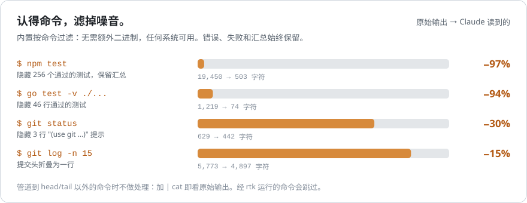
  </picture>
</p>

<p align="center"></p>

<p align="center">
  <picture>
    <source media="(prefers-color-scheme: dark)" srcset="../assets/readme/zh-CN/ladder-dark.svg">
    
  </picture>
</p>

<p align="center"></p>

<p align="center">
  <picture>
    <source media="(prefers-color-scheme: dark)" srcset="../assets/readme/install-dark.svg">
    
  </picture>
</p>

<details>
<summary><b>其他安装方式</b></summary>
<br>

```bash
# Claude Code 插件市场
claude plugin marketplace add JayPokale/Chisle
claude plugin install chisle@chisle

# curl
curl -fsSL https://raw.githubusercontent.com/JayPokale/Chisle/main/install.sh | bash
```

```powershell
# Windows
irm https://raw.githubusercontent.com/JayPokale/Chisle/main/install.ps1 | iex
```

各智能体的配置、升级和设置：[docs/usage.md](../docs/usage.md)。

</details>

<p align="center"></p>

<p align="center">
  <picture>
    <source media="(prefers-color-scheme: dark)" srcset="../assets/readme/zh-CN/commands-dark.svg">
    
  </picture>
</p>

<p align="center"></p>

<p align="center">
  <a href="https://www.star-history.com/?repos=JayPokale%2FChisle&type=date&legend=top-left">
    <picture>
      <source media="(prefers-color-scheme: dark)" srcset="https://api.star-history.com/svg?repos=jaypokale%2Fchisle&type=date&legend=top-left&theme=dark">
      
    </picture>
  </a>
</p>

<p align="center"></p>

<p align="center">
  <a href="https://buymeacoffee.com/jaypokale3b">
    <picture>
      <source media="(prefers-color-scheme: dark)" srcset="../assets/readme/zh-CN/support-dark.svg">
      
    </picture>
  </a>
</p>

<p align="center"><a href="https://github.com/JayPokale/Chisle/stargazers">⭐ 给仓库点个星</a>：一个 token 都不花。</p>

<p align="center">
  <a href="https://github.com/JayPokale/Chisle/graphs/contributors"></a>
</p>

<p align="center"><sub><a href="../LICENSE">MIT</a> · <a href="../CONTRIBUTING.md">参与贡献</a> · 最初由 <a href="https://github.com/JuliusBrussee/caveman">caveman</a> 和 <a href="https://github.com/DietrichGebert/ponytail">ponytail</a> 合并而来（<a href="../NOTICE">声明</a>）· 命令过滤器沿用 <a href="https://github.com/rtk-ai/rtk">RTK</a> 的设计</sub></p>
